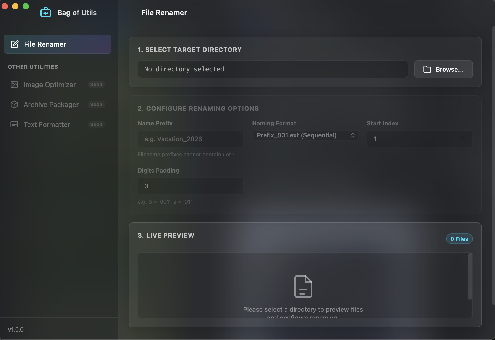

#  Bag of Utils

**Bag of Utils** is a modular, high-performance macOS utility application suite. Engineered to be ultra-lightweight and visually stunning, it brings native-grade desktop tools directly to your Mac.

The suite currently includes a robust, visual **File Renamer** for bulk renaming and a **Document Converter** for converting between PDF, EPUB, DjVu, DOCX, HTML, TXT, RTF and Markdown.

---

## 📸 Media Demonstration

### Application Interface Mockup


---

## 🌟 Key Features (File Renamer)

* **Multiple Naming Patterns**: Choose between sequential numbering (`Prefix_001.ext`, `Prefix-001.ext`, `Prefix 001.ext`) or prepending/reformatting (`Prefix_OriginalName.ext`).
* **Real-time Live Preview**: View exactly what the files will be renamed to *before* applying any changes.
* **Collision & Conflict Detection**: Identifies and flags name clashes (duplicate target names) before execution, keeping your data safe.
* **Vibrant macOS Integration**: Features native macOS vibrancy (frosted glass glassmorphism), borderless titlebar styling, native traffic-light buttons overlay, and direct Finder integration.
* **Stateless & Safe**: Operates directly on the directories you specify using native Cocoa filesystem APIs.

---

## 🔄 Key Features (Document Converter)

* **Many Formats**: Bidirectional conversion between **PDF**, **EPUB**, **DjVu**, **DOCX**, **HTML**, **TXT**, **RTF**, and **Markdown**.
* **Files or Folders**: Pick individual files or a whole folder; optionally choose a separate output folder.
* **Safe Queue Preview**: See every output name and status before converting. Choose **Auto-rename**, **Skip** or **Overwrite** when an output already exists. Duplicate outputs within a batch are flagged.
* **Hybrid Engine**: Works out of the box using built-in macOS tools (`textutil`, PDFKit, CoreText, `zip`/`unzip`). If [Calibre](https://calibre-ebook.com/) is installed, it is used automatically for higher-fidelity PDF/EPUB/DOCX/HTML/TXT/RTF conversions, with a fallback to the built-in engine.
* **Atomic Output**: Files are written to a temporary location first, so a failed conversion never leaves a partial file.
* **Self-Contained DjVu Engine**: Full reading and writing support for DjVu (`.djvu`) is 100% self-contained in native Swift with **zero external CLI dependencies** (no Homebrew, no `djvutxt`, and no `pdf2djvu` needed).
  - **Embedded Text Extraction**: Extracts text directly from native `TXTz` (BZZ-compressed) and `TXTa` chunks across single-page and multi-page (`DJVM`) documents.
  - **Vision OCR Fallback**: Scanned or image-only DjVu pages automatically fall back to Apple's built-in macOS Vision framework (`VNRecognizeTextRequest`) to extract text and layout.
  - **Bilevel JB2 Generation**: Writes valid, standard-compliant DjVu documents with compressed bilevel JB2 page masks and embedded searchable text layers.
* **Optional Fidelity Boosters**: If [Calibre](https://calibre-ebook.com/) is installed, it is auto-detected and used for enhanced fidelity when converting between ebook formats, otherwise falling back smoothly to the native engine.

---

## 🛠 Tech Stack

* **Native Wrapper & Shell**: Swift 5 (AppKit & WebKit frameworks)
* **Document Engine & OCR**: PDFKit, CoreText, CoreGraphics, and Apple Vision framework (`VNRecognizeTextRequest`)
* **Self-Contained Codecs**: Pure Swift ZP-coder arithmetic compression, BZZ (Burrows-Wheeler Transform + MTF), and JB2 bilevel image encoding/decoding
* **User Interface**: HTML5, Vanilla CSS3 (Glassmorphic theme with macOS vibrancy), ES6 JavaScript
* **IPC Communication**: Asynchronous Promise-based WebKit Script Message Bridge
* **Unit Testing**: Node.js Native Test Runner (`node --test`)
* **Assets & Bundle Compilation**: macOS `sips` (Scriptable Image Processing System) and `iconutil`

---

## 🚀 Prerequisites & Local Setup

### System Requirements
* macOS 10.15 (Catalina) or later.
* macOS Xcode Command Line Tools or full Xcode package (provides the `swiftc` compiler).
* Node.js v18.0.0 or later (for running unit tests).

### Quick Compilation & Setup

1. **Clone the Repository**:
   ```bash
   git clone https://github.com/paulang1807/bag-of-utils.git
   cd bag-of-utils
   ```

2. **Build the App Bundle**:
   Run the automated build script to compile the Swift source, package the resources, and output a double-clickable Mac app bundle under the `build/` directory:
   ```bash
   npm run build
   ```

3. **Run the App**:
   You can launch the compiled app immediately from your terminal or double-click `BagOfUtils.app` inside the `build/` directory in Finder:
   ```bash
   open build/BagOfUtils.app
   ```

---

## 🧪 Running Unit Tests

Validate the core renaming, indexing, padding, and conflict detection logic using the native Node.js test runner:
```bash
npm test
```

---

## 📖 Usage Guide

1. **Open a Target Folder**: Launch **Bag of Utils** and click **Browse...** to select the directory containing the files you wish to rename.
2. **Configure Naming Rules**:
   * Enter your desired **Name Prefix** (e.g. `Vacation`).
   * Select a **Naming Format** from the dropdown menu.
   * Adjust **Start Index** and **Digits Padding** values (options dynamically display based on format).
3. **Inspect the Preview**: View the files table in the live preview panel. Verify the destination names:
   * **Cyan highlights** indicate modified filenames.
   * **Faded rows** indicate unchanged filenames.
   * **Red highlights and warning icons** indicate name collisions.
4. **Execute**: When you are satisfied with the preview (and no conflicts exist), click **Rename Files**. The files will be renamed in-place and the preview list will refresh automatically.
5. **Quick Reveal**: Click **Show in Finder** at any point to open the folder and verify the changes on disk.

### Document Converter

1. Choose **Document Converter** in the sidebar.
2. Click **Select Files...** (one or more documents) or **Select Folder...** (all supported documents in a folder). Optionally set an **Output Folder...**; by default outputs are written next to their sources.
3. Choose the **Convert To** format, an optional **Source Filter**, and what to do **If Output Exists**.
4. Review the **Conversion Queue**. Rows show the output name and a status (Ready, Already target format, Will skip, Conflict).
5. Click **Convert Documents**. Per-file results (including failure reasons on hover) appear in the queue.

---

## 📂 Project Structure

```
bag-of-utils/
├── build.sh                 # Packages Resources, iconset & compiles App binary
├── package.json             # Project metadata, ES Modules setup, npm scripts
├── Info.plist               # macOS App Bundle property list configuration
├── docs/                    # Documentation images & media assets
│   ├── app-icon.png         # High-resolution master application icon
│   └── ui-screenshot.png    # Interface screenshot
├── src/
│   ├── swift/
│   │   ├── main.swift           # Native window controls & script IPC bridge
│   │   ├── converter.swift      # Multi-format conversion coordinator
│   │   ├── djvu_tables.swift    # ZP arithmetic coder probability tables
│   │   ├── djvu_codec.swift     # Pure Swift ZP and BZZ compression codecs
│   │   ├── djvu_jb2.swift       # Pure Swift JB2 bi-level image & symbol codec
│   │   └── djvu_document.swift  # IFF85/DJVM parser, OCR fallback & DjVu writer
│   └── web/                     # HTML/CSS/JS frontend
│       ├── index.html           # Main application view layout
│       ├── style.css            # Glassmorphism styling and themes
│       ├── renamer.js           # File renamer preview and pattern engine
│       ├── renderer.js          # Renamer UI event controller & IPC bridge
│       ├── converter.js         # Document converter format detection & queue preview
│       └── converter-ui.js      # Document converter UI event controller
└── test/
    ├── renamer.test.js          # Unit tests for renaming patterns & conflict detection
    └── converter.test.js        # Unit tests for format detection & conversion preview
```
